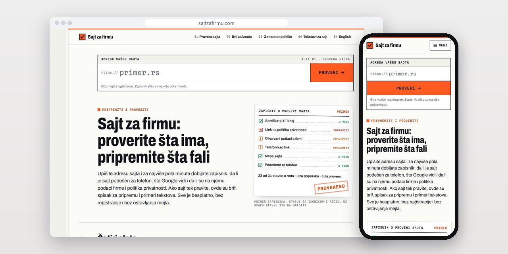
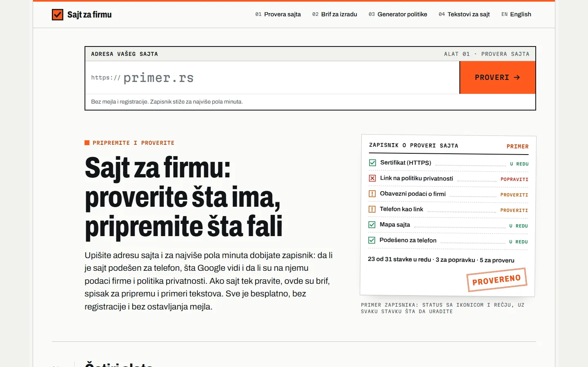
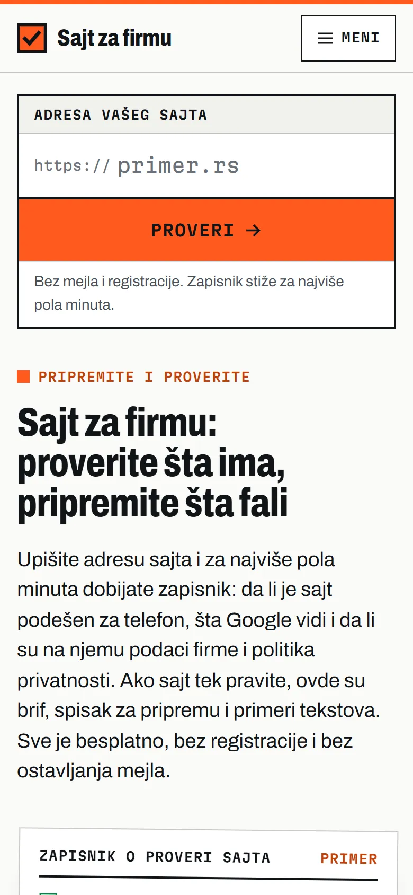
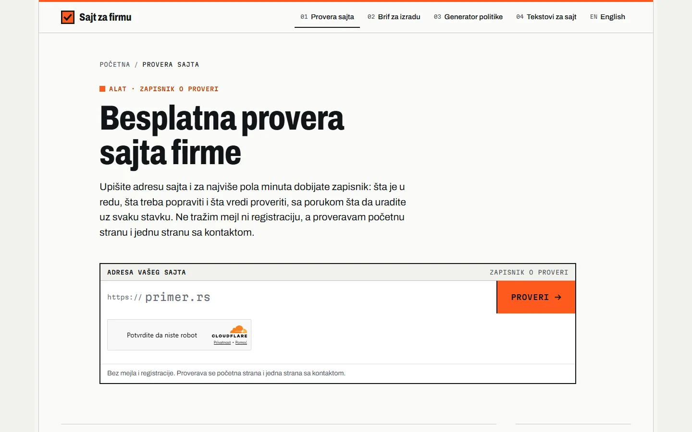

# Sajt za firmu

Alati za vlasnike koji tek naručuju ili sređuju sajt: provera sajta, brif, generator politike privatnosti i primeri tekstova.

**[sajtzafirmu.com](https://sajtzafirmu.com/)** · [Studija slučaja](https://svilenkovic.rs/radovi/sajt-za-firmu) · [English](README.md)

> [!NOTE]
> Moj sopstveni projekat, ne klijentski posao. Izvorni kod je privatan. Ova stranica opisuje šta sajt radi i kako je napravljen.

<table>
  <tr><td><b>Klijent</b></td><td>Sopstveni projekat</td></tr>
  <tr><td><b>Delatnost</b></td><td>Provera i priprema sajta za vlasnike firmi</td></tr>
  <tr><td><b>Lokacija</b></td><td>Srbija</td></tr>
  <tr><td><b>Vrsta</b></td><td>Sajt sa alatima i proverom sajta</td></tr>
  <tr><td><b>Moj deo posla</b></td><td>Istraživanje, dizajn, izrada, SEO i hosting</td></tr>
  <tr><td><b>Tehnologije</b></td><td>Astro 7, GSAP DrawSVG, PHP 8.3, SQLite, nginx</td></tr>
</table>

## O projektu

Pre nego što naruči nov sajt ili sredi stari, firmi obično trebaju tri odgovora: šta na sadašnjem sajtu ne valja, šta tačno naručuje i koji pravni tekstovi moraju da stoje. Sajt za firmu ima alat za svako od tih pitanja, bez naloga i bez ostavljanja mejla. Brif i generator politike privatnosti rade samo u pregledaču i ništa ne šalju.

Provera sajta je jedini deo kome treba server. PHP 8.3 servis otvori početnu stranu i jednu stranu sa kontaktom i vrati zapisnik od 36 stavki u šest grupa, od sertifikata i preusmerenja do podataka o firmi koje traži Zakon o elektronskoj trgovini. Servis koji otvara bilo koju adresu koju posetilac upiše mora da pazi, pa pre svakog zahteva proverava kuda ime vodi i odbija lokalne i privatne adrese, a radi u zasebnom PHP-FPM bazenu, bez funkcija za pokretanje programa.

## Šta sam uradio

- Provera sajta sa 36 stavki u šest grupa, uz svaku piše šta treba uraditi
- Najviše dvanaest zahteva ka proveravanom sajtu, rezultat se čuva deset minuta u SQLite bazi, a broj provera ograničen je po hešu IP adrese
- Zapisnik radi i bez JavaScript-a: obična forma dobija isti zapisnik kao HTML stranu
- Brif koji se preuzima za Word ili štampa i generator politike privatnosti koji prati član 23 Zakona o zaštiti podataka o ličnosti
- Štiklovi koje iscrtava GSAP DrawSVG, učitan tek kad posetilac pokrene proveru

## Merenja

| | Performanse | Pristupačnost | Dobre prakse | SEO |
| :-- | :-: | :-: | :-: | :-: |
| Telefon | 100 | 100 | 100 | 100 |
| Desktop | 100 | 100 | 100 | 100 |

PageSpeed Insights, laboratorijsko merenje živog sajta, oktobar 2026. Sigurnosna zaglavlja: 6 od 6. axe provera pristupačnosti: bez prekršaja. Strukturisani podaci: `FAQPage`, `Person`.

## Snimci ekrana

<table>
  <tr>
    <td width="68%" valign="top"></td>
    <td width="32%" valign="top"></td>
  </tr>
</table>

Provera sajta: upišete adresu i dobijete zapisnik

---

Izrada: [D. Svilenković](https://svilenkovic.rs).
